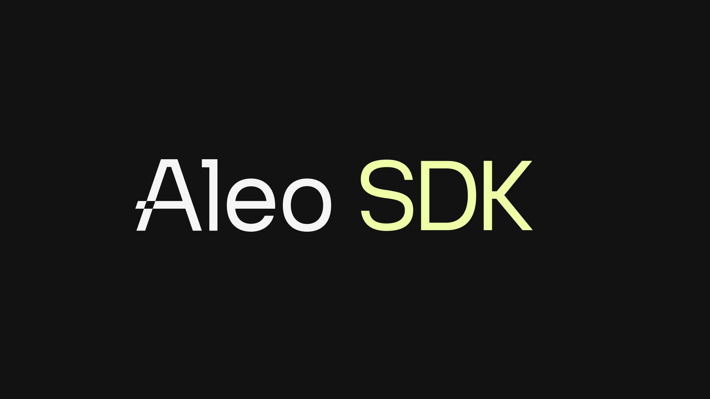

# Provable SDK

    

    
    
    
    
    

The [Provable SDK](https://github.com/ProvableHQ/sdk) provides low-level [Aleo](https://aleo.org) protocol utilities and
JavaScript/TypeScript helpers for developers who need direct access to cryptographic primitives, zk-SNARKs, accounts,
records, program execution and deployment, transfers, staking, and network APIs. It re-exports core
[SnarkVM](https://github.com/ProvableHQ/snarkVM) objects for building wallets, servers, CLI tools, and zero-knowledge
applications. The SDK runs in browsers, scripts, and server-side JavaScript.

## Veil

Use [Veil](https://github.com/ProvableHQ/veil#readme) for viem-like Aleo APIs in browser apps, server-side JavaScript, and AI agents.

| Package                                                                                           | Purpose                                                                   | Documentation                                                                            |
| ------------------------------------------------------------------------------------------------- | ------------------------------------------------------------------------- | ---------------------------------------------------------------------------------------- |
| 🧩 [veil-core](https://www.npmjs.com/package/@provablehq/veil-core)                               | Viem-like clients, actions, transports, and types.                        | [README](https://github.com/ProvableHQ/veil/blob/main/packages/core/README.md)           |
| 🔑 [veil-aleo-sdk](https://www.npmjs.com/package/@provablehq/veil-aleo-sdk)                       | Accounts, signing, proving, and records through the Provable SDK.         | [README](https://github.com/ProvableHQ/veil/blob/main/packages/provable-sdk/README.md)   |
| 👛 [veil-aleo-wallet-adapter](https://www.npmjs.com/package/@provablehq/veil-aleo-wallet-adapter) | Connect Aleo wallets to Veil clients for signing, proving, and records.   | [README](https://github.com/ProvableHQ/veil/blob/main/packages/wallet-adapter/README.md) |
| 🌉 [aleo-bridge-sdk](https://www.npmjs.com/package/@provablehq/aleo-bridge-sdk)                   | Bridge assets into and out of Aleo.                                       | [README](https://github.com/ProvableHQ/veil/blob/main/packages/bridge/README.md)         |
| 🦁 [veil-leo](https://www.npmjs.com/package/@provablehq/veil-leo)                                 | Build and deploy Leo programs from JavaScript/TypeScript.                 | [README](https://github.com/ProvableHQ/veil/blob/main/packages/leo/README.md)            |
| 🧪 [veil-aleo-devnode](https://www.npmjs.com/package/@provablehq/veil-aleo-devnode)               | Local nodes, block mining, and snapshots for Foundry-like test harnesses. | [README](https://github.com/ProvableHQ/veil/blob/main/packages/devnode/README.md)        |

## Applications

Applications built with the Provable SDK include:
* **Private DeFi**
* **Private Data Custody Systems**
* **Zk Games & Gaming Toolkits**
* **ZkML**
* **Zero-Knowledge Identity Management**
* **Aleo Wallets**

## Features
The Provable SDK provides the following features. Follow the links below for live demonstrations of these features on
[provable.tools](https://provable.tools)
1. [Aleo account management](https://provable.tools/account)
2. [Aleo cryptographic primitives](https://provable.tools/algebra)
3. [Zero-knowledge program execution and deployment](https://provable.tools/develop)
4. [Aleo credit transfers and staking](https://provable.tools/transfer)
5. [Management of program state](https://provable.tools/protocol)
6. [Communication with the Aleo network](https://provable.tools/rest)

## Start Building

Use the following resources to build with the SDK's protocol utilities.

### [The SDK Guide](https://docs.explorer.provable.com/docs/sdk/6p7047svvq2ox-intro-to-aleo)

A step-by-step guide to creating Aleo accounts, transferring and receiving Aleo credits, executing and deploying
Aleo programs, and managing private and public state with the Provable SDK.

### [Create-Leo-App](https://docs.leo-lang.org/sdk/create-leo-app/tutorial)

Runnable SDK examples and templates for Node.js and frameworks such as React and Next.js. Install and run them with
the `create-leo-app` command line tool. Examples include private NFTs and offline transaction signing.

### [SDK API Documentation](https://docs.explorer.provable.com/docs/sdk/0qgi3uyhotv62-account)
For developers who prefer to dive straight into the code, the SDK API documentation provides a comprehensive reference
for all the SDK's classes, methods, and interfaces. The documentation is generated from the SDK's TypeScript source code.

### [Leo Language Documentation](https://docs.leo-lang.org)
Leo is an imperative language for writing zero-knowledge programs on Aleo. Use the SDK to deploy and execute programs
written in Leo.
